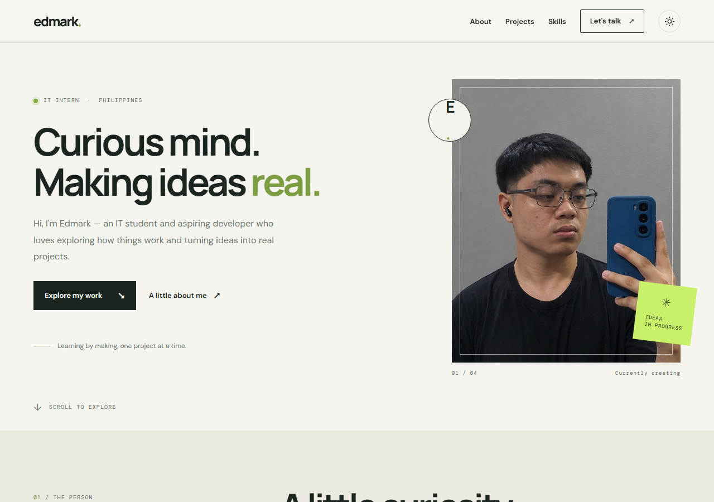

# Edmark Portfolio

A responsive personal portfolio for Edmark, an Information Technology student and aspiring developer in the Philippines.

<p align="center">
  <a href="https://my-intern-portfolio-project.vercel.app/">
    
  </a>
</p>

<p align="center">
  <a href="https://my-intern-portfolio-project.vercel.app/">
    
  </a>
</p>

## About

The portfolio introduces Edmark, highlights selected projects and skills, and provides ways to get in touch.

## Features

- Responsive layout for desktop and mobile
- About, projects, skills, and contact sections
- Light and dark themes
- Keyboard-accessible mobile navigation and project carousel
- Resume download
- Contact form that opens the visitor's default email application

## Demo walkthrough

1. **Home** — The introduction and portrait lead into the rest of the portfolio.
2. **About** — Read a short bio and download the resume.
3. **Projects** — Browse six selected projects. Use the carousel controls or scroll the project row; project cards link to GitHub.
4. **Skills** — Explore the technologies and the projects where they are used.
5. **Contact** — Fill in the form to open a pre-addressed, pre-filled message in the visitor's default email application. The form does not send messages directly from the website.

The navigation adapts to smaller screens, and the theme button switches between light and dark modes.

## Project files

```text
.
├── index.html                 # Portfolio page
├── style.css                  # Layout, responsive styles, and themes
├── script.js                  # Navigation, theme, carousel, and contact behavior
├── README.md                  # Project details and demo walkthrough
└── assets/
    ├── portfolio-preview.png  # README demo preview
    └── ...                    # Project images and downloadable resume
```

## Deployment

The live portfolio is deployed on Vercel: [my-intern-portfolio-project.vercel.app](https://my-intern-portfolio-project.vercel.app/). Push changes to the connected repository to trigger a new deployment.

## Customization

- Edit page content and project links in `index.html`.
- Update colors, typography, and layout in `style.css`.
- Update interactions in `script.js`.
- Replace images and the resume in `assets/`, keeping their filenames or updating references in `index.html`.
